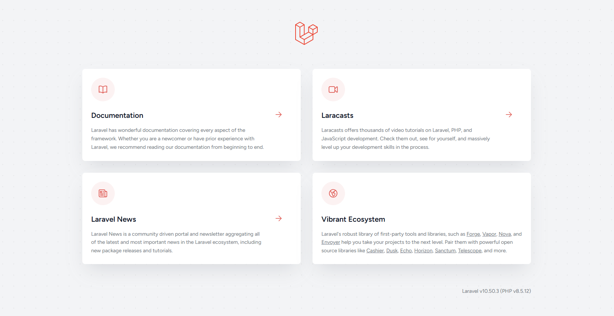
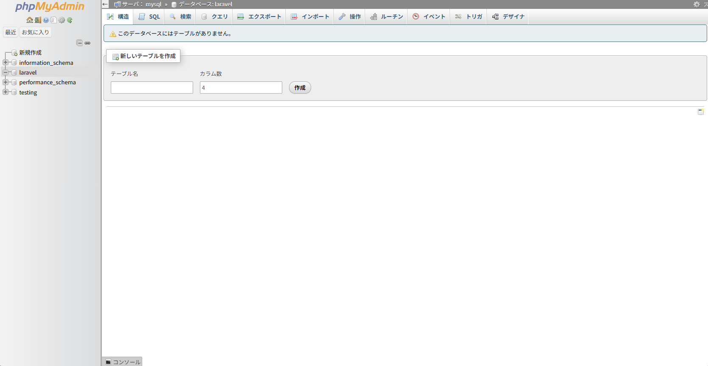

# setup-app-practice

## 概要
COACHTECH 教材 Tutorial 9-1-7「環境構築ハンズオン」で作成した成果物です。
Laravel SailとDockerを使って、Tutorial 9〜10 のハンズオンで使う開発環境を構築しました。

## 使用技術
- PHP 8.5.12
- Laravel 10.50.3
- Laravel Sail（Docker Compose）
- MySQL, phpMyAdmin

## 学んだこと
- Laravel Sailを使ったDocker上での開発環境を構築する方法
- .envファイルの設定確認や、compose.yamlへのphpMyAdminサービスの追加
- アプリケーションキーの生成やエイリアス設定による簡潔なコマンドでの実行

## 動作確認
1. setup-app-practiceディレクトリ上でsail up -dによりyamlファイルに記述した構成通りのコンテナを起動させてネットワークで連携
2. ブラウザで「`http://localhost`」のURLにアクセスしてLaravelウェルカムページが表示されることを確認
3. ブラウザで「`http://localhost:8080`」のURLにアクセスしてphpMyAdmin画面が表示されること、laravelデータベースがあることを確認

## 開発の工夫
- Laravel学習用の専用ディレクトリを作成し、さらに今回のハンズオン用のサブディレクトリを作成することで、Laravelプロジェクトが増えても管理がしやすいようなディレクトリ構成にした
- 10/21に公表されたPHPの脆弱性に伴い、PHPが修正後のバージョン(8.5.12)であることを確認した

## 動作確認のスクリーンショット
1. 「`http://localhost`」にアクセスした時のLaravelウェルカムページ

2. 「`http://localhost:8080`」にアクセスした時のphpMyAdmin画面

